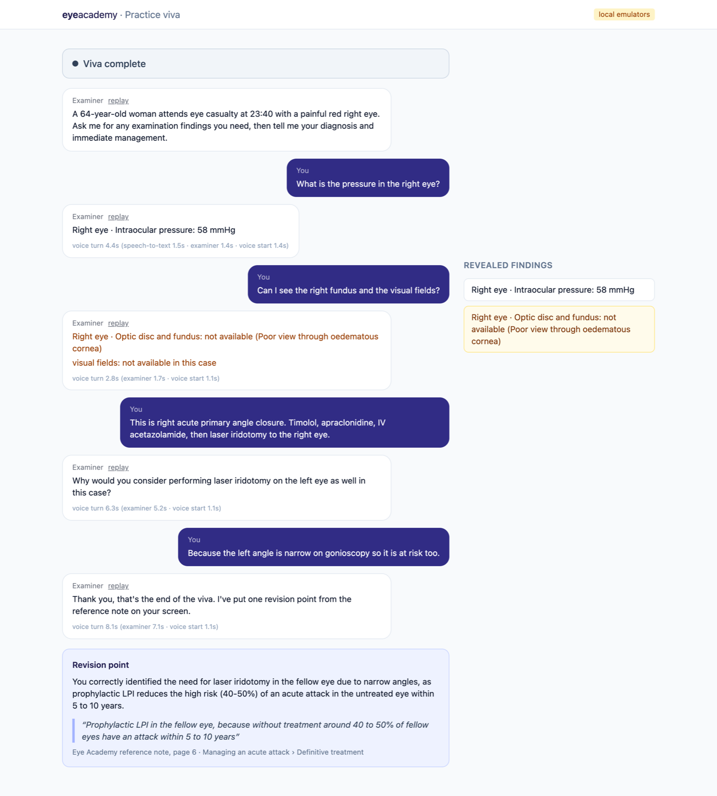
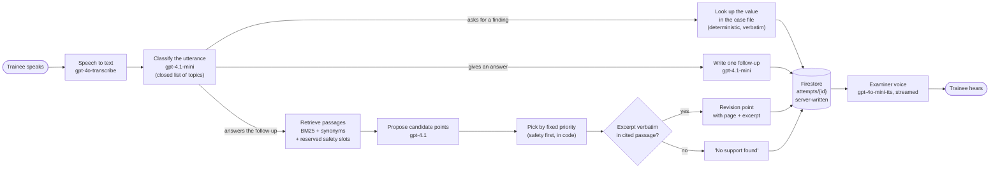

# Eye Academy practice viva

A short, spoken ophthalmology viva. A signed-in trainee asks the examiner for findings aloud, gives a diagnosis and management plan, answers one follow-up question, and gets one revision point cited from the Eye Academy reference note.

**Live:** https://eye-academy-viva.vercel.app (sign in with Google)

Stack: TanStack Start (React, server functions) · Firebase Auth (Google) and Firestore · OpenAI (speech-to-text, reasoning, text-to-speech) · Vercel.



*A completed viva, run locally against the Firebase emulators. Timings vary between runs; in this one turns took 2.8–8.1 s.*

## How a turn works



The model never produces a finding value: it only chooses which topic and which eye were asked for. Everything shown or spoken about the case comes from the case file through a deterministic lookup, and every citation is checked against the passage it cites.

## What works

| Requirement | How |
|---|---|
| Ask for findings aloud; read back and display with the correct eye, value and unit | The model only chooses *which* finding and *which eye* from a closed list built from the case file. The value is then looked up deterministically and shown verbatim ("Right eye · Intraocular pressure: 58 mmHg"). Speech is generated from the same text with clinical notation expanded ("6/36" → "six thirty-six", "mmHg" → "millimetres of mercury"). |
| Say when a finding is unavailable | Unavailable findings are read out with the case's reason ("Right eye · Optic disc and fundus: not available (Poor view through oedematous cornea)"). Anything the case doesn't contain ("visual fields") gets "isn't available in this case"; no value is ever invented. |
| One spoken follow-up that responds to the trainee | When the trainee gives a diagnosis and management, the examiner asks one question about something specific in their answer. **Patient safety comes first**: if the plan gives acetazolamide to this patient (sulfonamide allergy) or leaves the precipitating antihistamine running, that's what gets asked. Otherwise the question is steered by the case's follow-up ideas. |
| Clear turn-taking | A status banner shows *Your turn*, *Listening*, *Transcribing*, *Examiner is responding* and *Examiner is speaking*. The mic is tap-to-start / tap-to-stop (or Space), and the examiner can be skipped. Typing is available as a fallback. |
| Saved attempts, private to the owner | Attempts live in Firestore (`attempts/{id}`). The browser can only **read** its own attempts; every write goes through a server function that verifies the Firebase ID token and ownership (`firestore.rules`, tested against the emulator). After a refresh the transcript and revealed findings reload. |
| Revision point from the reference note | After the follow-up, relevant passages are retrieved, the model proposes candidate points, and the server picks the **most important gap** by a fixed priority: unsafe drug for this patient → precipitating drug left running → missed key point → incorrect statement → reinforcement. Anything the trainee already covered is dropped. The point cites a page and a short excerpt, which must appear verbatim in the cited passage; otherwise the trainee is told no support was found. |

## Time and where I stopped

About **2¾ hours** in total, within the four-hour limit: about 2 hours on the brief, then about 45 minutes on polish.

- **Built first:** the deterministic case lookup and speech formatting, reference-note preprocessing and retrieval with the citation guard, the viva engine (findings → follow-up → revision point), Firestore rules, the voice UI, and saved attempts. All of it ran end to end on the Firebase emulators, including a scripted browser run through a fake microphone.
- **Then:** the real Firebase project with Google sign-in, Vercel deployment, CI, and fixes for three problems that only appeared in production: Google sign-in returning to the sign-in screen, and two bundling issues. Then the built-server smoke test, so those can't come back unnoticed, and this README and `pnpm checks`.
- **Polish, after that:** consistent formatting checked in CI, the screenshot and diagram above, the end-to-end browser test in CI, and **safety-first feedback**. Every run showed the revision point missing the case's most important error: acetazolamide for a patient with a sulfonamide allergy. The follow-up and revision point now put patient safety first (check 4).
- **Stopped before:** the follow-up latency improvement below (designed, not built), testing recording on Safari/iOS, and a custom domain.

## Run it locally

Requirements: Node 22+, pnpm 8 (`corepack enable`), Java 21 (for the Firebase emulators), an OpenAI API key with access to `gpt-4.1-mini`, `gpt-4o-transcribe` and `gpt-4o-mini-tts`.

```bash
pnpm install
cp .env.example .env          # set OPENAI_API_KEY; leave the Firebase values empty

pnpm emulators                # terminal 1: Auth :9099, Firestore :8080, UI :4000
pnpm dev:local                # terminal 2: http://localhost:3000
```

With empty Firebase values the app runs entirely against the local emulators (project `demo-eye-academy`, no Google account needed). On the sign-in page, open **Test account (local emulator only)** to create an email/password account, or use the emulator's Google sign-in.

To run against a real Firebase project, fill in the `VITE_FIREBASE_*` values, `FIREBASE_PROJECT_ID`, and a service-account key (`GOOGLE_APPLICATION_CREDENTIALS=./service-account.json`, git-ignored), then run `pnpm dev`.

| Command | What it does |
|---|---|
| `pnpm checks` | The repeatable checks below, through the real pipeline (needs `OPENAI_API_KEY`) |
| `pnpm test` | Unit tests: case lookup, speech normalisation, retrieval regressions, citation guard, signed speech tokens, viva engine with a stubbed model |
| `pnpm test:rules` | Firestore security-rules tests against the emulator |
| `pnpm test:e2e` | A whole viva in a real browser (Playwright) against the emulators and the real OpenAI models: a voice question through a fake microphone, an unavailable finding, a request the case doesn't contain, the follow-up, the revision point, a reload, and a second account denied. Run `pnpm emulators` first; CI uses `pnpm test:e2e:ci` |
| `pnpm smoke` | Starts the **built** server (`NITRO_PRESET=node-server pnpm build` first) with `require()` of ES modules disabled, as on Vercel, and starts a viva with a real ID token against the real Firebase project; cleans up after itself |
| `pnpm typecheck` / `pnpm lint` | TypeScript and Biome |
| `pnpm preprocess:reference` | Rebuilds `data/reference-index.json` from the PDF |

## Repeatable checks

`pnpm checks` runs each check through the same code the app uses and prints expected vs observed. The brief asks for three; the fourth covers the safety-first behaviour. Results from the latest run:

| Check | Input | Expected | Observed | Result |
|---|---|---|---|---|
| **1. Available finding** | "What's the pressure in the right eye?" | `Right eye · Intraocular pressure: 58 mmHg`, right eye only; spoken "58 millimetres of mercury" | `Right eye · Intraocular pressure: 58 mmHg`; spoken "Right eye: intraocular pressure, 58 millimetres of mercury." | PASS |
| **2. Unavailable finding** | "Can I see the right fundus?" | `Right eye · Optic disc and fundus: not available (Poor view through oedematous cornea)`, no value | Same line, result kind `unavailable` | PASS |
| **3. Citation supports the revision point** | Answer: "Right acute angle closure. Topical timolol, apraclonidine and pilocarpine, analgesia and an antiemetic, stop the chlorphenamine, then laser iridotomy to the right eye." Follow-up: "Why would you consider laser iridotomy on the left eye as well?" Reply: "I don't know." | Supported; cites p.6 *Managing an acute attack › Definitive treatment* (fellow-eye LPI); excerpt verbatim | **Retrieved pages:** 7 (LPI › Indications), 6 (Managing an acute attack › Definitive treatment), 7 (LPI › Technique), 8 (Secondary angle closure › Pushing mechanisms), 7 (LPI › Complications), 5 (Managing an acute attack › Immediate treatment), 4 (Acute primary angle closure › Triggers). **Chosen as** missed key point. **Cited:** p.6, *"Prophylactic LPI in the fellow eye, because without treatment around 40 to 50% of fellow eyes have an attack within 5 to 10 years (higher figures are reported in some series)."*; verbatim check passed. The trainee already said to stop the chlorphenamine, so that was not picked. | PASS |
| **4. Safety first** | Answer: "Right acute angle closure. Topical timolol and apraclonidine, IV acetazolamide, then laser iridotomy to the right eye." (acetazolamide for a patient with a sulfonamide allergy, never mentioned). Follow-up generated live. Reply: "I'm not sure." | The follow-up asks about the allergy; the revision point is about the sulfonamide allergy, citing an excerpt that mentions it, not the fellow eye | **Follow-up:** "Given her sulfonamide allergy, how would you manage the use of acetazolamide in this patient?" **Chosen as** unsafe drug for this patient. **Cited:** p.6 *Managing an acute attack › Immediate treatment*, *"Check for sulfonamide allergy, kidney disease, low potassium and sickle cell disease before giving it."*; verbatim check passed. | PASS |

Checks 3 and 4 run through the same engine the app uses. The wording of the revision point varies between runs; what is asserted is the chosen category, the cited page and heading, and the verbatim check. Each was run three times in a row with the same result. The unit tests cover the rest with a stubbed model: the priority order regardless of the order the model lists candidates, dropping what the trainee already covered, one retry when the chosen excerpt isn't verbatim, and refusing ("no support found") if the retry fails too.

The same flow was also run by hand on production (Google sign-in, real microphone): pressures, right fundus unavailable, answer, follow-up about the left eye, revision point citing p.6, and the attempt still there after a refresh.

## Models and responsiveness

| Step | Model | Why |
|---|---|---|
| Speech to text | `gpt-4o-transcribe` | Accurate on clinical vocabulary; a short prompt biases it towards terms like "gonioscopy", "Van Herick", "acetazolamide". |
| Intent, follow-up | `gpt-4.1-mini` | Strict structured output (Zod schemas), low latency, cheap. The model never produces a finding value: it returns topic keys from a closed enum. |
| Revision point | `gpt-4.1` | It has to label candidate points reliably (is this a safety issue? did the trainee already cover it?). `gpt-4.1-mini` mislabelled the sulfonamide-allergy gap in repeated runs; `gpt-4.1` got it right every time. It runs once per viva, at the end, so the extra ~1–3 s and ~1¢ are acceptable. |
| Examiner voice | `gpt-4o-mini-tts` (voice `sage`) | Steerable tone ("calm consultant examiner"), streams MP3 so playback starts on the first bytes. |

**Alternative considered: the OpenAI Realtime API** (speech-to-speech). It would cut latency, since there is no separate transcription and synthesis step. But the model would speak the findings itself, which makes it much harder to guarantee that the eye, value and unit are exactly the case file's. The chained pipeline keeps a deterministic lookup between understanding and speaking; that guarantee is the core requirement, so it won.

**Measuring a voice turn.** The timer **starts when the trainee stops recording** (tap or Space, `performance.now()` in the browser) and **stops when the examiner's audio starts playing** (the `<audio>` element's `playing` event). That is the silence the trainee actually waits through. Each examiner turn shows the breakdown under it, e.g. `voice turn 3.9s (speech-to-text 0.9s · examiner 1.8s · voice start 1.2s)`.

Measured on production (function in London, client in Turkey over a VPN):

| Turn | Total | Speech-to-text | Examiner (server) | Voice start |
|---|---|---|---|---|
| Ask for a finding ("What are the pressures?") | 3.9 s | 0.9 s | 1.8 s | 1.2 s |
| Unavailable finding ("Can I see the right fundus?") | 4.1 s | 1.2 s | 1.6 s | 1.3 s |
| Diagnosis → follow-up question | 5.5 s | 1.3 s | 3.0 s | 1.2 s |
| Follow-up answer → revision point | 4.6 s | 0.8 s | 2.5 s | 1.3 s |

The follow-up turn is slowest because it makes two model calls in sequence (classify the utterance, then write the question).

## How the reference note was prepared

`scripts/preprocess-reference.ts` turns the PDF into `data/reference-index.json` once, before the demo:

- **Structure from typography, not regex.** Text is extracted with `unpdf` together with font size and position. ~15.5 pt lines are section headings, ~11.5 pt are sub-section headings, ~10.3 pt is body text, and running headers/footers are dropped by position. Vertical gaps and bold lead-ins separate paragraphs, bullets and table rows; table cells are re-joined per row.
- **Page-scoped chunks.** One chunk is one sub-section *on one page*. A sub-section that crosses a page break becomes two chunks with the same heading, so every citation maps to exactly one printed page number. That gives 34 chunks across 10 pages.

**Selecting relevant passages.** At ~34 chunks, lexical retrieval is deterministic, explainable and needs no embeddings. `MiniSearch` (BM25) indexes heading and text, with headings boosted ×2, light prefix/fuzzy matching and stop-words removed. Two things were added after a retrieval test failed:

- **Clinical synonym expansion.** Trainees say "the left eye"; the note says "the fellow eye". A short, reviewable table adds the textbook terms ("left/other eye" → "fellow eye prophylactic", "laser" → "laser peripheral iridotomy LPI", "diamox" → "acetazolamide", "doesn't come down" → "does not fall").
- **Two queries fused by reciprocal rank.** The follow-up exchange (short and specific) and the main answer are searched separately and fused, so the long answer cannot drown out the follow-up.

**Safety passages get reserved slots.** Two short queries built from the case, *the patient's allergies against the drugs in the answer* and *her current drugs as possible triggers* (drug names only; doses dilute the query), each add their top 2 passages. In a fused ranking, a passage that matches only one query loses to passages matching several, which is how "check for sulfonamide allergy before giving acetazolamide" (p.6) was being missed.

**The model proposes; the code decides.** The passages go to `gpt-4.1` with their ids and pages, together with the case's allergies, current drugs and key points. It returns up to four candidate points. Each has a category, whether the trainee's own words already cover it, the passage id, and an excerpt copied from that passage. The server drops anything already covered and picks by a fixed priority (patient safety first). Ranking is in code because the model was reliable at labelling individual candidates but not at applying a ranking rule across them. The server then checks that the excerpt appears **verbatim** in that passage (case, whitespace and typographic quotes normalised; `…` allowed only to skip words, in order). If the check fails, or the model cites a passage it wasn't given, the trainee is told no support was found rather than shown an unverified citation.

## Architecture

```
src/
  domain/case/        case schema, topic catalogue, deterministic lookup, display + speech formatting
  domain/reference/   chunk schema, BM25 retrieval, synonym expansion, verbatim-citation guard
  domain/attempt.ts   shape of a saved attempt (shared client/server)
  server/viva/        engine (phases: findings → follow-up → completed), intent, follow-up, revision
  server/*.ts         Firebase Admin, OpenAI clients, signed speech tokens, server functions
  routes/             sign-in + attempts list, viva screen, /api/tts/$id (streams examiner audio)
  lib/                browser Firebase, auth hook, recorder and player
firestore.rules       owner-only reads, no client writes
```

- **Server-written attempts.** The browser reads its own attempt live from Firestore but cannot write it, so a trainee cannot forge revealed findings or a revision point.
- **The examiner only speaks its own text.** Each examiner line is issued as an HMAC-signed, short-lived token carrying the text; `/api/tts/<token>` streams speech only for valid tokens, so the endpoint is not an open text-to-speech proxy on the API key. It is stateless, so it works across serverless instances.
- **The answer key stays on the server.** The case file (diagnosis, examiner notes) is only bundled server-side; the client bundle was checked for it.
- **Cost guards for the public demo:** at most 5 attempts per account and 40 turns per attempt; optional `ALLOWED_EMAILS` allow-list.

## Delivery

- Pull requests run CI (GitHub Actions): typecheck, lint, unit tests, Firestore rules tests on the emulator, a production build, a smoke test of the built server against the real Firebase project, and the end-to-end browser test. The smoke test exists because two early production failures only appeared once the app was bundled and a real Google ID token was verified; it reproduces both.
- Vercel builds a preview for each PR and deploys production when a PR is merged to `main`. Server functions run in `lhr1` (London).
- Google sign-in on the deployed site uses the app's own domain as the Firebase auth domain (`/__/auth/*` is proxied to firebaseapp.com), so it survives browsers that partition third-party storage.

## Known limitations

- **Preview deployments:** Google sign-in only works on authorised domains, so it fails on per-PR preview URLs. Production works.
- **Safari / iOS recording** uses the `audio/mp4` path, which hasn't been tested on a device.
- **`*.vercel.app` is blocked by some Turkish ISPs' "safe internet" filters.** A custom domain avoids this.
- **The diagnosis → follow-up turn is the slowest (~5.5 s)** because its two model calls run in sequence.

## Next improvement

**Cut the follow-up turn's latency by overlapping its two model calls.** Today the server classifies the utterance, then, if it is an answer, writes the follow-up question. Starting the follow-up call speculatively alongside classification (and discarding it when the utterance turns out to be a finding request) should bring that turn from ~5.5 s to roughly the ~4 s of a findings turn. That is the moment the trainee has just committed to an answer and waits longest. Streaming the follow-up text straight into text-to-speech would save a little more.
